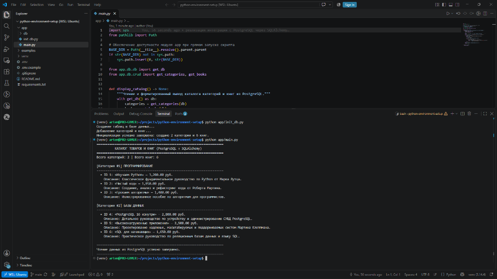

# Настройка рабочей среды и работа с PostgreSQL в Python

Репозиторий содержит проект на Python для работы с реляционной базой данных PostgreSQL через ORM SQLAlchemy в среде WSL 2 (Ubuntu).

## Выполненные требования

- Установлена СУБД PostgreSQL в среде WSL 2.
- Создан пользователь базы данных `octagon` и база данных `octagon_db`.
- Создано и активировано изолированное виртуальное окружение `venv`.
- Установлены зависимости: `SQLAlchemy`, `psycopg2-binary`, `python-dotenv`.
- Настроен файл `.gitignore`: виртуальное окружение `venv/` и файл секретов `.env` исключены из репозитория.
- Добавлен файл конфигурации `.env.example` с шаблоном параметров подключения.
- Реализованы модули работы с базой данных в каталоге `app/db/`:
  - `db.py`: подключение через SQLAlchemy и фабрика сессий.
  - `models.py`: декларативные модели таблиц `categories` и `books` со связью один-ко-многим.
  - `crud.py`: функции создания, чтения, обновления и удаления записей.
- Разработан модуль `app/init_db.py` для пересоздания таблиц и наполнения начальными данными.
- Модуль `app/main.py` считывает записи из базы данных и выводит каталог в консоль.
- Снимок экрана с результатом работы сохранен в каталог `examples/`.

## Структура проекта

```text
python-postgresql-sqlalchemy/
├── app/
│   ├── db/
│   │   ├── __init__.py
│   │   ├── crud.py
│   │   ├── db.py
│   │   └── models.py
│   ├── init_db.py
│   └── main.py
├── examples/
│   └── vscode_screenshot.png
├── .env.example
├── .gitignore
├── README.md
└── requirements.txt
```

## Структура базы данных

### Таблица `categories`
- `id`: первичный ключ, целочисленный.
- `title`: название категории, строковое, уникальное.

### Таблица `books`
- `id`: первичный ключ, целочисленный.
- `title`: название книги, строковое.
- `description`: текстовое описание книги.
- `price`: цена товара, числовая с фиксированной точкой.
- `url`: ссылка на товар.
- `category_id`: внешний ключ на таблицу `categories`.

## Установка и запуск

1. Клонируйте репозиторий:

```bash
git clone https://github.com/ArtemChik103/python-postgresql-sqlalchemy.git
cd python-postgresql-sqlalchemy
```

2. Создайте и активируйте виртуальное окружение:

```bash
python3 -m venv venv
source venv/bin/activate
```

3. Установите зависимости проекта:

```bash
pip install -r requirements.txt
```

4. Скопируйте файл конфигурации и задайте параметры подключения:

```bash
cp .env.example .env
```

5. Инициализируйте таблицы и заполните базу данных начальными записями:

```bash
python app/init_db.py
```

6. Запустите вывод каталога:

```bash
python app/main.py
```

## Результат работы


